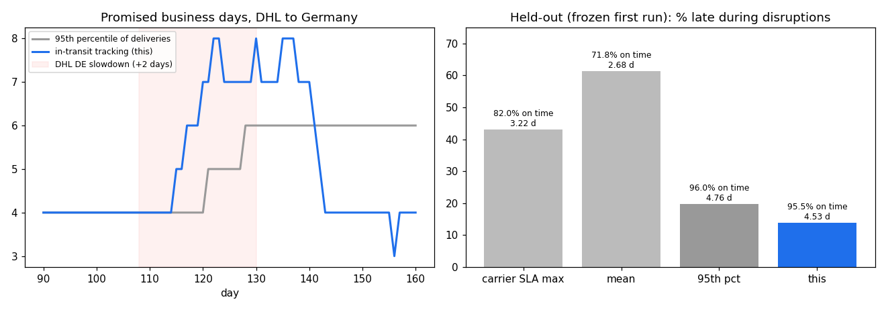

# Delivery promises that move with the carrier — before the late parcels land

Unofficial prototype by Kushagra Pratap Singh. Not affiliated with Pango.

Pango's delivery checkout shows "estimated delivery dates" and "AI-driven delivery estimates" ([pango.ai](https://pango.ai/)). The date shown at checkout is a promise. If it's too long, conversion drops. If it's too short, it turns into "where is my order" tickets. The hard part is a carrier that slows down: an estimate built from **delivered** parcels learns about the slowdown only after the late parcels finally arrive. Then it keeps the long promise for weeks after the lane recovers.

This repo is a small engine plus a simulator to measure that.



## What it does
- **Calendar.** Swedish business days: weekends, Easter, midsummer eve, national day, Christmas and so on. A 14:00 warehouse cutoff and handling slips. Promises are counted in business days from the ship day.
- **Baselines:**
  - the carrier's SLA text (the "1–3 days" upper end);
  - the lane's historical mean;
  - the lane's 95th percentile of the last 600 deliveries (pooled with the carrier when a lane is thin).
- **In-transit tracking promise (this).** It reads what tracking already shows today:
  1. **Promise d is judged on parcels whose d-day outcome is already known.** A parcel shipped 6 business days ago and still out is already late for any promise under 6 days. It counts now, not when it finally arrives. The promise is the smallest d that the latest 150 such parcels kept (at most 7 late).
  2. **A slowdown shift from parcels that are not due yet.** Normally about half the lane's parcels are still out after k ≈ median days. When far more of the latest 40 are still out than history says, the lane has slowed by s days, and s is added. This shows a +2-day slowdown before any promise is missed.
- **Simulator.** About 68k orders over 6 months per seed:
  - carriers PostNord, DHL, Bring and UPS; Nordic and EU zones;
  - lognormal transit per lane;
  - disruptions: temporary slowdowns, and a lane that gets permanently slower.

Each method sees only deliveries known by the end of the previous day, plus "not delivered yet". A test checks this: changing the future does not move earlier promises.

## Results
**Held-out**: [`heldout/config.json`](heldout/config.json), frozen in git (commit `048813b`) before the first run. It covers an autumn peak, a new zone (PL), a Bring strike, a PostNord peak slowdown, and DHL to DE becoming permanently slower. 3 seeds, 245k orders (207k scored after a 4-week warm-up). First run, nothing changed after it ([`out/heldout_first_run.json`](out/heldout_first_run.json)):

| method | on time (target 95%) | avg promise | late during disruptions |
|---|---|---|---|
| carrier SLA text, upper end | 82.0% | 3.22 d | 7,530 / 17,450 (43%) |
| historical mean | 71.8% | 2.68 d | 10,715 (61%) |
| lane 95th percentile | 96.0% | 4.76 d | 3,445 (20%) |
| **in-transit tracking (this)** | **95.5%** | **4.53 d** | **2,425 (14%)** |

So, compared with the 95th percentile: promises are 0.23 business days shorter on average, and there are 30% fewer late orders during disruptions. On-time stays above the 95% target.

Dev (3 seeds, used for tuning COHORT/MAX_LATE): 95th pct 96.7% / 3.98 d / 24% late in disruptions; this 96.4% / 3.87 d / 20%.

## Honest limits
- **It overshoots.** In the demo slowdown, the promise climbs to 7–8 days while the true slowdown was about 2 days. That comes from discrete steps, plus the slowdown shift being added on top of a cohort that is already late. It comes back down about a week after recovery; the 95th percentile stays at 6 for weeks. A smoother combination is the next thing to try.
- **The first days of a slowdown can't be caught by delivery-time data alone.** Detection is limited by how long a parcel needs to be "visibly out". Carrier scan events (hub arrival, customs) would cut this further; they are not simulated.
- **Synthetic carriers and lanes.** Real per-lane transit, holidays at the destination, and service levels would come from tracking history.

## Run
```
pip install numpy matplotlib pytest
python demo.py                      # one lane, one slowdown, week by week
python evaluate.py heldout          # the table above (~70 s); python -m pytest -q  (6 tests)
```
